# Nour Academy Platform

A browser-based platform for **Nour Academy**, a network of three tutoring and language centres in Nador, Morocco (Nador Centre, Hay Al Matar and Selouane). It brings together three applications that were first built as separate projects:

| Space | Who it is for | Entry page |
| --- | --- | --- |
| **Parent portal** | Parents and students | [`index.html`](index.html) |
| **Back office** | The secretary and the director | [`dashboard.html`](dashboard.html) |
| **Teacher area** | Teachers | [`teacher/index.html`](teacher/index.html) |

**Live site:** https://nour-academy-platform-lime.vercel.app/

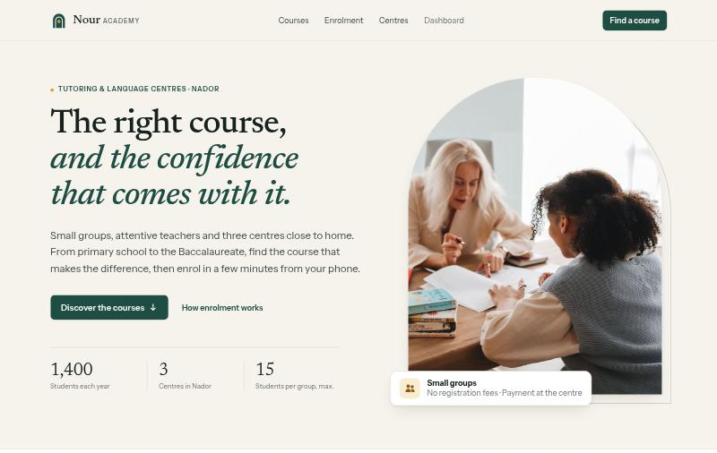

## Contents

- [Introduction](#introduction)
- [Project evolution and consolidation](#project-evolution-and-consolidation)
- [Application architecture](#application-architecture)
- [Key features](#key-features)
- [Technologies and tools](#technologies-and-tools)
- [UI/UX and design improvements](#uiux-and-design-improvements)
- [Screenshots](#screenshots)
- [Project structure](#project-structure)
- [Installation and local development](#installation-and-local-development)
- [Deployment](#deployment)
- [Original projects and their documentation](#original-projects-and-their-documentation)
- [Design system and UI/UX reference](#design-system-and-uiux-reference)
- [Known limitations](#known-limitations)
- [Future improvements](#future-improvements)
- [Author and credits](#author-and-credits)

## Introduction

Nour Academy welcomes about 1,400 students a year, from primary school to the Baccalaureate. Before this project, its daily work relied on WhatsApp messages, a PDF brochure, three Excel files and paper attendance sheets. The project briefs list the consequences:

- **Registrations:** 1 parent in 4 could not find the right course, and 35% of registration files were incomplete or wrong. The secretaries spent about 15 hours a week calling parents back.
- **Administration:** 1 registration in 10 was entered twice, the monthly payment report took the director two days, and 18 groups went over the 15-student limit in one session.
- **Teaching:** parents learned about absences at the end of the month, and calculating a group's averages took two hours.

The platform addresses each of these: parents send a complete, validated file from their phone; the secretariat manages registrations without duplicates or over-full groups and gets its figures in one click; teachers take attendance and enter grades on their phone and see which students are on alert the same day.

The three applications cover one workflow and share the same data model, so they now live in one repository, one build and one deployment. A registration sent from the parent portal appears directly in the secretary's table, the validation rules are written once and shared, and all three spaces use one visual identity.

## Project evolution and consolidation

Nour Academy was built in three parts, each with its own brief and its own GitHub repository (see [Original projects](#original-projects-and-their-documentation)):

1. **Part 1 — Parent registration portal** (individual project).
2. **Part 2 — Secretariat back office** (team project). Its repository already contained a later copy of the Part 1 portal, extended to save registrations for the back office.
3. **Part 3 — Teacher area** (individual project).

The consolidation brought them into this repository with one rule: **integrate, don't rewrite**. Business rules, workflows and data structures were kept. Code was changed only where integration required it, or to fix a bug against the original briefs.

**How it was done**

- The back office repository was used as the base, because it already contained the portal and the shared registration storage. Its Git history is kept.
- The teacher area was added under `teacher/` with `git subtree`, which keeps its own Git history.
- One `package.json` and one `vite.config.js` now build all pages. The teacher area moved from Vite 8 to Vite 6 (used by the other two parts); its code needed no change for this.
- The only integration change in the teacher area's code: its page loaded `/src/main.js`, which would have loaded the portal's script once inside `teacher/`, so the path became `./src/main.js`.
- Each space keeps its own entry stylesheet, so their styles cannot clash.

**Fixes made during consolidation** (each one restores a requirement from the original briefs)

| Space | Fix |
| --- | --- |
| Portal | The password rule (8+ characters, an uppercase letter, a digit, a special character) was missing; only "passwords match" was checked. |
| Portal | The same student can no longer be registered twice in one course, or in a group that already has 15 students. |
| Portal | The "add at least one course" error now clears when a course is added (a Part 1 fix lost in the Part 2 copy). |
| Portal | Phone numbers are saved without spaces, so the back office phone search finds them. |
| Back office | Validation rules are imported from a shared module (`src/validation.js`) instead of being absent from the add form (Part 2, US2). |
| Back office | Adding or editing refuses duplicates and groups that already have 15 students, with a message in the form. |
| Back office | Search, filter and sort are kept for the session in `sessionStorage` (Part 2, US5). |
| Back office | The button labelled "Reset filters" actually reset the data: it is now "Reset demo data" and asks for confirmation. |
| Back office | Added registrations could reappear after a second reset; resets now start from a copy of the demo data. |
| Back office | Names are escaped before being inserted into the table, so text containing HTML is shown, not executed. |
| Teacher area | The "Sort" list and the student record dialog existed in the page but were not connected; both now work (Part 3, B1 and B3). |
| Teacher area | A `for…of` loop, which the Part 3 brief forbids, was replaced by `reduce`. |

**UI/UX.** After integration, the three spaces were given one visual identity: colours, typography, components and interactions. This changed the presentation layer (HTML structure, classes and styles, and the HTML strings that the JavaScript generates), not the behaviour. See [UI/UX and design improvements](#uiux-and-design-improvements).

**Differences from the original briefs** that come from earlier choices in the original projects and were kept as they were: the interface is in English (Part 1 asked for French), and the site is deployed on Vercel rather than GitHub Pages.

## Application architecture

There is **no backend**. Each space is a static HTML page with its own JavaScript entry point (native ES modules), bundled by Vite.

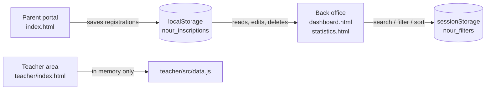

### Parent portal

**For:** parents (persona: Fatima, on an entry-level phone) and students (Yassine, comparing courses).
Parents browse the course catalogue, filter it, build a selection with a monthly total, and fill in a registration form that is checked while they type. On submission, each selected course becomes a registration saved in the browser, under one file number shown to the parent.

### Back office

**For:** the secretary (Khadija, 1366 px PC) and the director (Mr. Bennani, tablet from 768 px).
One page with two views, switched from the sidebar without reloading:

- **Registrations** (secretary): the full table of registrations, with search, filter, sort, pagination, and add / edit / delete.
- **Statistics** (director): revenue collected, registrations by status, and the occupancy of each course against the 15-student limit.

`statistics.html` is a standalone read-only version of the statistics view, kept from the original back office.

### Teacher area

**For:** teachers (Laila, taking attendance on her phone) and the director (who follows students on alert).
The teacher chooses a group, marks absences, enters grades and adds students who arrive during the year. A side panel shows the group's figures and the parents to call. This space has its own data (`teacher/src/data.js`): its groups and students are **not linked** to the portal's courses and registrations, as in the Part 3 brief.

### Access and authentication

None of the three spaces has a login or roles, as in the original projects. All data stays in the visitor's own browser, and the demo data is fictitious, so nothing is exposed. Per-role access for the secretary, the director and the teachers would need the server planned for a later phase (see [Future improvements](#future-improvements)).

## Key features

Only features present in the code are listed here. Bonus items from the briefs that were **not** built are listed in [Future improvements](#future-improvements).

### Parent portal

- Catalogue of 12 courses generated in JavaScript from `src/data/courses.js` (title, subject, level, schedule, centre, price, seats left). A course with no seats left shows "Full" and its button is disabled.
- Filters by level and subject, plus a keyword search on the title and subject; they combine without reloading. The number of results is shown, with a message when nothing matches.
- A selection panel: add and remove courses (no duplicates), monthly total in MAD, and a button to go to the form. All card buttons work through one delegated event listener.
- A registration form with a message under each field, updated as the user types: parent's name, email, Moroccan mobile number (`06/07` + 8 digits or `+212 6/7` + 8 digits), student's name and level, password (8+ characters, uppercase, digit, special character) and confirmation, and an unticked consent box with a Law 09-08 information notice.
- Submission is blocked, with focus on the first invalid field, if a field is invalid, consent is missing, the selection is empty, the student is already registered in a selected course, or a selected course already has 15 registrations.
- On success: a summary with the student, the courses, the monthly total and a unique file number (`NA-<year>-<timestamp>`), then the form and selection are reset. The registration is saved for the back office.

### Back office

- Registrations stored in `localStorage`. On first launch, 25 fictitious registrations are loaded (`src/data/data.js`). If the stored data is unreadable, the demo data is restored.
- Table with file number, student, level, course, parent's phone, status (*Pending*, *Validated*, *Paid*) and date, paginated by 10 rows.
- Instant, case-insensitive search by student name or phone number; filter by status; sort by name or date in both directions. All three combine and are remembered for the session.
- **Add** a registration received at the counter, and **edit** one (pre-filled form) in a dialog. Both check the name and phone number with the shared rules, and refuse a duplicate (same student, same course) or a course that already has 15 registrations.
- **Delete** after a confirmation.
- **Reset demo data**, after a confirmation.
- **Statistics** view: revenue collected from *Paid* registrations (e.g. "3,250 MAD"), number of registrations, count per status, and occupancy per course with a progress bar (red when a group is full). The figures update after every change.
- Changes made in another tab (for example, a registration sent from the portal) are picked up through the browser's `storage` event.

### Teacher area

- Student list built with the DOM API from `teacher/src/data.js` (3 groups, 31 fictitious students). Each card shows the name, absences and average ("13.5 / 20", or "—" without grades).
- A group selector and an instant search by first or last name; they combine, with a result counter and a "no student" message.
- **Absent** and **Add grade** buttons handled by one delegated listener. Grades must be numbers from 0 to 20. At 3 absences, the card switches to an alert style with a "Notify parents" badge.
- **Add a student**: first name, last name, group, parent's email, parent's phone and a temporary access code, each checked as the user types, with a strength gauge for the code. Adding is refused for a duplicate in the same group or a group that already has 15 students. The access code is neither shown nor stored.
- **Group summary**: average, total absences, number of students on alert, best student average, and the list of parents to call (or "No students on alert").
- **Sort** by name or by average, on a copy of the list.
- **Student record** dialog with all of a student's grades, closed with Esc, the ✕ button or a click outside.
- Changes are kept in memory only and are lost on reload (the Part 3 brief requires no persistence).

## Technologies and tools

Everything below is taken from `package.json`, `vite.config.js` and the source files.

| Area | What is used |
| --- | --- |
| Languages | HTML5, CSS, JavaScript (ES modules, no framework) |
| Build tool | [Vite](https://vite.dev/) 6, multi-page build (`index.html`, `dashboard.html`, `statistics.html`, `teacher/index.html`) |
| Styling | [Tailwind CSS](https://tailwindcss.com/) v4 through `@tailwindcss/vite`, with a shared theme in `styles/theme.css` |
| Icons | [Font Awesome Free](https://fontawesome.com/) 7 (`@fortawesome/fontawesome-free`) |
| Fonts | Newsreader and Instrument Sans, self-hosted through [Fontsource](https://fontsource.org/) (`@fontsource-variable/*`) |
| Data storage | Browser `localStorage` (registrations) and `sessionStorage` (back office filters); in-memory arrays for the teacher area |
| Backend, database, API | None |
| Authentication | None |
| Hosting | [Vercel](https://vercel.com/) |

No environment variables, API keys or external services are used. Fonts and icons are bundled, so the pages make no requests to third-party servers.

## UI/UX and design improvements

The redesign gave the three spaces one identity without changing how they work. Everything is defined once in [`styles/theme.css`](styles/theme.css) and imported by both entry stylesheets.

| Element | Choice |
| --- | --- |
| Idea | Warm limestone backgrounds, cedar green, and one saffron accent (*nour* means "light") used sparingly |
| Logo | An arch, like a doorway, with a point of light inside ([`images/logo.svg`](images/logo.svg)) |
| Colours | `paper` / `paper-2` / `card` surfaces, `line` borders, `ink` / `ink-soft` / `muted` text, `brand` (cedar green), `saffron` (accent), `ok` (green) and `alert` (terracotta) states |
| Typography | Newsreader (serif) for headings and key figures; Instrument Sans for text, forms and tables |
| Shape and depth | Radii from 6 to 22 px (fully rounded only for badges); four soft shadow levels |
| Components | Shared classes for buttons (`.btn-primary`, `.btn-secondary`, `.btn-ghost`, `.btn-icon`), fields (`.input`, `.form-field`), cards, status badges, key-figure tiles (`.kpi`), progress bars (`.meter`), tables (`.data-table`) and dialogs (`.modal`) |
| Motion | Short colour and shadow transitions, a 1 px lift on buttons and cards, a brief fade-up for lists and dialogs; all disabled when the user's system asks for reduced motion |

How each space applies it:

- **Parent portal:** an editorial home page with a large serif headline, the academy's key figures and a photo in an arch-shaped frame; course cards with clear seat badges; a selection panel that stays in view while scrolling; a form beside a three-step explanation; the centres presented as a list rather than more cards.
- **Back office:** a sidebar grouped by role (Secretariat, Management) with a clear active state; a single toolbar for search, filter and sort; a table with coloured status badges and an empty state; statistics led by revenue, with occupancy bars per course; dialogs with a header, grouped fields and inline errors.
- **Teacher area:** large touch targets (44 px minimum) for taking attendance on a phone; terracotta alert cards; a summary panel using the same key-figure tiles as the back office.

Responsive behaviour was checked at 375 px (phone), 768 px (tablet), 1366 px (the secretary's PC) and 1440 px. Validation states (success in green, error in terracotta) use the brand colours.

## Screenshots

All screenshots were taken from the live site.

### Parent portal

| Course catalogue and selection | Registration form with live validation |
| --- | --- |
| 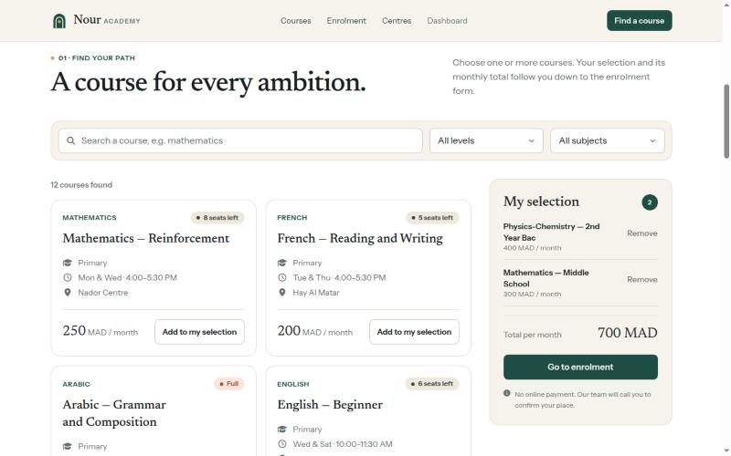 | 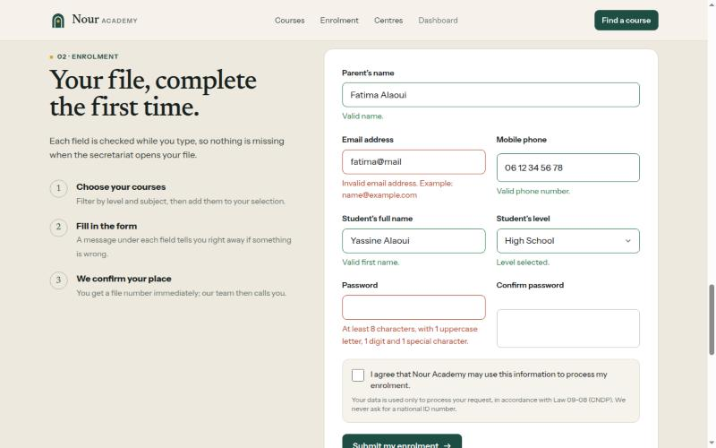 |

### Back office

| Registrations (secretary) | Statistics (director) |
| --- | --- |
| 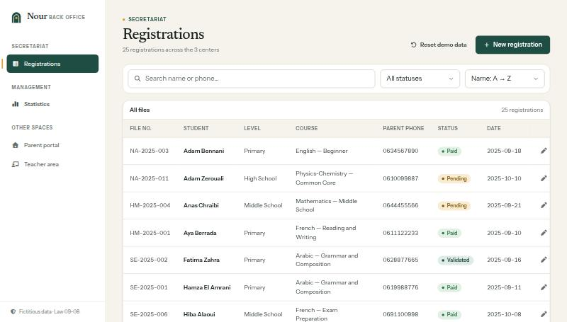 | 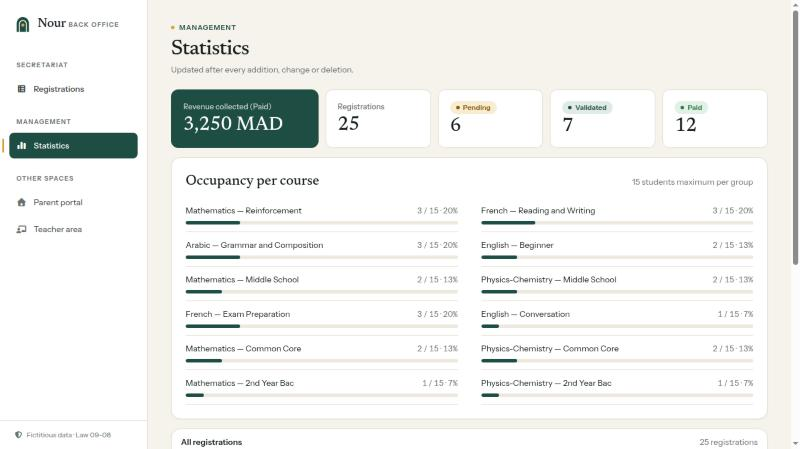 |

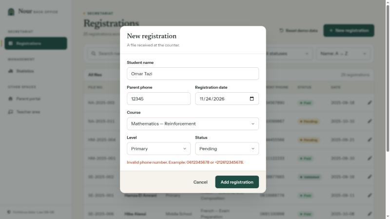

### Teacher area

| Attendance and group summary | Adding a student |
| --- | --- |
| 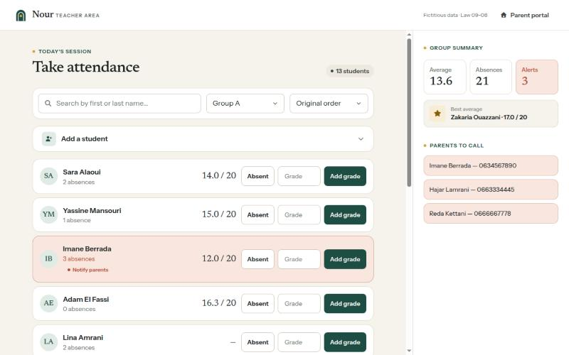 | 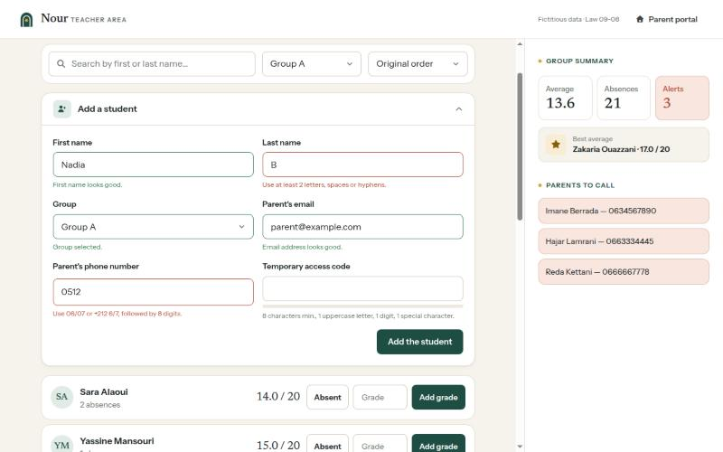 |

| Student record | On a phone |
| --- | --- |
| 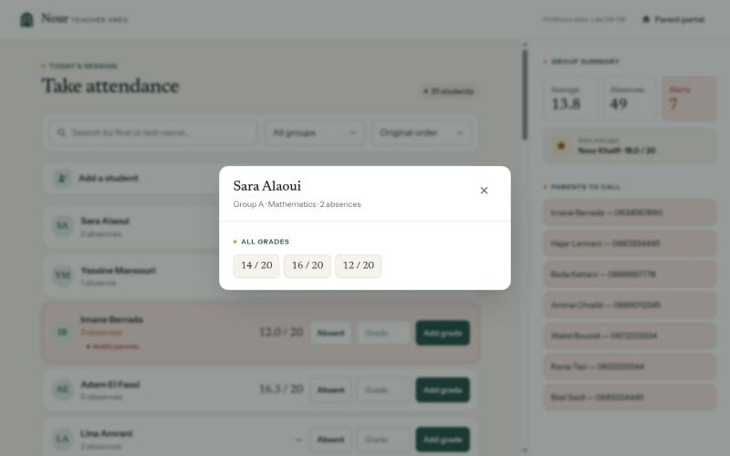 | 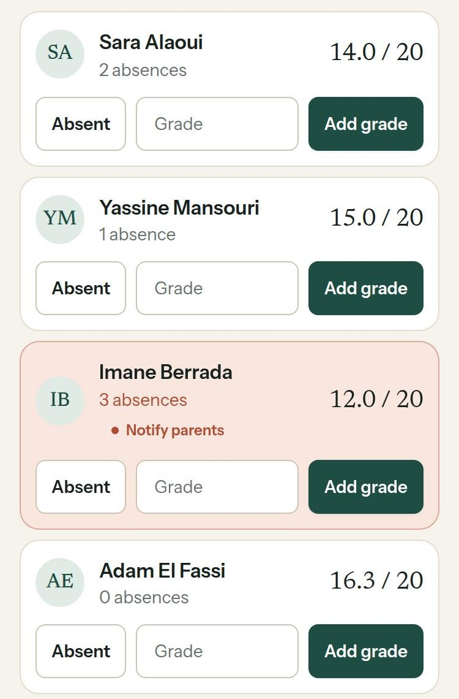 |

## Project structure

```text
nour-academy-platform/
├── index.html              Parent portal
├── dashboard.html          Back office (Registrations and Statistics views)
├── statistics.html         Standalone statistics page (back office)
├── images/
│   ├── hero.jpg            Home page photo
│   └── logo.svg            Nour Academy logo
├── styles/
│   ├── theme.css           Shared design system (colours, fonts, components, motion)
│   └── styles.css          Stylesheet of the portal and back office
├── src/                    Portal and back office scripts
│   ├── main.js             Portal: catalogue, filters, selection
│   ├── form.js             Portal: registration form and submission
│   ├── validation.js       Shared rules: phone, email, password, name, duplicates, 15-student limit
│   ├── storage.js          localStorage: load, save, reset demo data
│   ├── dashboard.js        Back office: table, search, filter, sort, pagination, add / edit / delete, statistics
│   ├── statistics.js       Standalone statistics page
│   ├── utils.js            Statistics calculation, HTML escaping
│   ├── ui/table.js         Registrations table rendering
│   └── data/
│       ├── courses.js      The 12 courses
│       └── data.js         25 fictitious demo registrations
├── teacher/                Teacher area
│   ├── index.html
│   └── src/
│       ├── data.js         3 groups and 31 fictitious students
│       ├── main.js         List, search, attendance, grades, add a student, summary, sort, record
│       └── styles.css      Stylesheet of the teacher area (imports the shared theme)
├── docs/
│   ├── briefs/             The three original project briefs
│   └── screenshots/        Screenshots used in this README
├── package.json
├── package-lock.json
└── vite.config.js          Multi-page build configuration
```

## Installation and local development

**Requirements:** [Node.js](https://nodejs.org/) 18 or later, and npm.

```bash
git clone https://github.com/0xm3d/nour-academy-platform.git
cd nour-academy-platform
npm install
npm run dev
```

Vite prints the local address (usually `http://localhost:5173/`). The three spaces are at:

| Space | Path |
| --- | --- |
| Parent portal | `/` |
| Back office | `/dashboard.html` |
| Standalone statistics | `/statistics.html` |
| Teacher area | `/teacher/` |

**Environment variables:** none are needed.

**Other scripts:**

```bash
npm run build     # production build into dist/
npm run preview   # serve the production build locally
```

**Demo data:** the back office's demo registrations are written to `localStorage` the first time a page that uses them is opened. Use **Reset demo data** in the back office to restore them.

## Deployment

The site is deployed on **Vercel** from this repository: https://nour-academy-platform-lime.vercel.app/

Vercel detects the Vite project and uses its defaults:

| Setting | Value |
| --- | --- |
| Framework preset | Vite |
| Build command | `npm run build` |
| Output directory | `dist` |

`vite.config.js` declares the four HTML pages as build inputs and sets `base: "./"`, so every asset path is relative. Pushing to `main` triggers a new deployment.

## Original projects and their documentation

The platform comes from three independent repositories. Their briefs are kept in this repository for traceability. They describe what was originally asked for, with their requirements unchanged; this README describes what the unified platform does today.

| Original project | Description | GitHub repository | Project brief |
| --- | --- | --- | --- |
| Parent registration portal (Part 1) | Course catalogue, selection and validated registration form for parents | [0xm3d/Nour-Academy](https://github.com/0xm3d/Nour-Academy) | [Project brief](docs/briefs/public-registration.md) |
| Secretariat back office (Part 2) | Registration management and statistics for the secretary and the director | [0xm3d/Nour-Academy-Back-Office](https://github.com/0xm3d/Nour-Academy-Back-Office) | [Project brief](docs/briefs/back-office.md) |
| Teacher area (Part 3) | Attendance, grades, student addition and group summary for teachers | [0xm3d/Nour-Academy-Teacher-Space](https://github.com/0xm3d/Nour-Academy-Teacher-Space) | [Project brief](docs/briefs/teacher-space.md) |

## Design system and UI/UX reference

The Figma file for the unified platform is the design reference for the redesign described above:

**[Nour Academy Platform — Figma](https://www.figma.com/design/DtmYOxPLSlMLvP0Iv1TadL/Nour-Academy-Platform)**

In code, the design system lives in [`styles/theme.css`](styles/theme.css).

## Known limitations

- **No authentication:** anyone with the link can open the back office and the teacher area (see [Access and authentication](#access-and-authentication)).
- **Data is per browser:** registrations live in one browser's `localStorage`, so two devices do not share data.
- **Seats shown in the catalogue are static:** they come from `courses.js` and do not decrease with new registrations. The 15-student limit is still enforced when a registration is sent or added.
- **Teacher data is not saved:** changes are lost on reload, and teacher groups are not linked to the portal's courses.

## Future improvements

These are **not** implemented.

- **Backend and API** (the "phase 3" mentioned in the Part 2 brief): shared data across devices, and real logins with roles for the secretary, the director and the teachers.
- **Connect the teacher area to registrations**, so a student registered through the portal appears in the right teacher group.
- **Group management in the teacher area:** creating and editing groups (today the three groups are fixed in `teacher/src/data.js`).
- **Seats left computed from registrations** instead of the static numbers in `courses.js`.
- **Bonus items from the original briefs not built yet:**
  - Part 1: password strength gauge (B2), course details in a modal (B3), two-step form with a progress bar (B4).
  - Part 2: CSV export (B1), undo the last deletion for 5 seconds (B3), URL navigation with `#/registrations` and `#/dashboard` (B4).

## Author and credits

- **Author:** Mohamed Bouhadi ([@0xm3d](https://github.com/0xm3d))
- **Part 2 (back office)** was built as a team project; see the [original repository](https://github.com/0xm3d/Nour-Academy-Back-Office) for its history.
- **Briefs:** project briefs from the training programme, presented as requests from the Sahla Digital agency (see [`docs/briefs/`](docs/briefs/)).
- **Hero photo:** Polina Tankilevitch on [Pexels](https://www.pexels.com/photo/6929183/) (Pexels licence).
- **Fonts:** Newsreader and Instrument Sans (SIL Open Font License), via Fontsource. **Icons:** Font Awesome Free.

All names, phone numbers and registrations in the demo data are fictitious (Law 09-08, CNDP).
